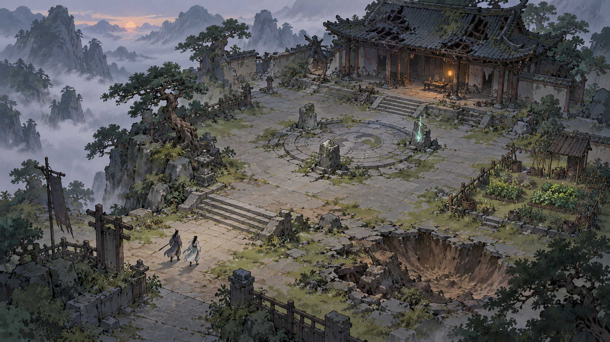

# Severed Heaven — Art Direction

Visual target endorsed 2026-10-24; native production guidance updated 2026-10-25. The starter geometry is a comparison placeholder, not final-art acceptance.

## Direction

Simplified painted Chinese cultivation fantasy: organic brushwork, weathered architecture, misty mountain depth, human-scale cultivators, and luminous martial techniques. Preserve the combat study's spectacle, aerial motion, and physical scale while reducing its faceted appearance. The user requested Tale of Immortal as a visual reference and explicitly loved the generated ruined-sect concept.

Reference source: [Tale of Immortal's official Steam listing](https://store.steampowered.com/app/1468810/_Tale_of_Immortal/). The reference establishes a shared point of discussion; our composition, characters, architecture, interface, and assets are original. Broad painted shapes, restrained outlines, and atmospheric depth are our proposed interpretation. The generated concept is the directly reviewed visual target.

The concept establishes atmosphere and composition, not a required per-asset detail level or a working screenshot. It has more small surface detail than the intended economical production kit. Simplify roof tiles, foliage marks, rubble, and masonry while preserving silhouettes, broad value groups, and focal light.

## Visual rules

| Element | Target | Avoid |
| --- | --- | --- |
| Ground | Continuous painted color, broad slope shading, sparse brush texture | Visible triangular color patches and regular cell patterns |
| Stone | Rounded/weathered masses, irregular contours, a few broad shadow planes | Repeated geometric facets or outlines on every face |
| Trees | Asymmetric canopy masses, brushy edges, trunk character, coherent shadow | Identical circular clusters or dense noisy leaf strokes |
| Architecture | Chinese timber structures, tiled eaves, stone plinths, legible structural wear | Random ornament, uniform pristine blocks, interchangeable cultural motifs |
| Cultivators | Upright painted figures with clear robe, hair, weapon, and movement silhouettes | Detail that disappears at combat distance or unreadable ally colors |
| Distance | Muted mountains, softer edges and reduced contrast with depth | Fog over the active fight that conceals threats |
| Techniques | Sharp luminous focal shape with controlled glow, brush-like trails | Bright white coverage that hides the battlefield |
| Destruction | Earth-colored crater walls, broken silhouettes, rubble and dust | Flat dark circles, polygon confetti, cosmetic scars detached from collision |
| Interface | Quiet parchment/ink materials, clear modern legibility, restrained jade/gold | Ornate frames consuming the combat view |

Use roughly two or three primary value groups per prop. Reserve fine marks for focal architecture and close inspection. The image's tiny figures establish scale; actual gameplay characters and target indicators may need greater visual emphasis at normal zoom.

## Palette and light

Starting palette, subject to in-engine color checks:

- Deep ink `#253234`: outlines, deep foliage, structural accents.
- Weathered slate `#777F7A`: stone and roof base.
- Moss `#6F7D58`: ground accents and age.
- Muted jade `#819A88`: living foliage and cool midtones.
- Warm parchment `#D8C7A3`: lit stone, paper, subdued highlights.
- Umber `#665044`: timber and exposed soil.
- Lantern amber `#E9B56D`: shelter and welcoming activity.
- Pale spiritual jade `#B2E6CE`: formation energy, used sparingly.

Dusk suits the opening chapter; it does not mandate permanent darkness. Restoration adds warmth, maintained surfaces, activity, and spiritual vitality. A prosperous sect retains its geography and recognizable architecture. Hostile telegraphs require contrast and shape coding independent of this environment palette.

## Camera, scale, and readability

Start with the existing elevated orthographic 2.5D camera and physical altitude rules. The concept's mountain vista is background inspiration; don't force the gameplay camera into a perspective it cannot support. Keep feet, shadows, altitude cues, and the target's actual hit space aligned. Occluding roofs/trees fade or cut away near actors. Any diagnostic view retained needs functional aiming and hazard readability.

Normal combat zoom must show an identifiable player, target, attack windup, ground height, and escape route. Cinematic zoom can reveal realm scale but must return predictably. Test paintings at gameplay scale, not only at full image resolution.

## Terrain and destruction implementation

Historical browser terrain/scenery used flat-colored triangles and procedural sprites. Native `scripts/terrain.gd` currently supplies vertex-colored mesh triangles and `scripts/proving_grounds.gd` supplies placeholder meshes. Replace their visual treatment while preserving canonical physical state and dirty-chunk boundaries.

Keep the physical height field, collision, mutation stamps, and dirty chunk caching. The renderer may still use triangles internally; remove their visual prominence through continuous height/normal shading, coherent ground texture, and organic transition masks. Do not blur the entire finished frame: actors, indicators, collision edges, and text need to remain sharp.

Painted ground is a replaceable surface treatment over simulated terrain. Rebuild crater shading and texture only in affected chunks. Props need intact, damaged, and destroyed silhouettes or deliberate disappearance/debris rules tied to actual durability. A baked full-scene painting cannot represent arbitrary excavated ground accurately and should not replace the simulation view.

Use a hybrid Godot approach: lightweight dynamic terrain and effects plus a small original painted kit, testing billboards, simple textured meshes or sprites in 3D before choosing the production representation. Prototype transitions, overlap margins, sprite anchors, and occlusion before producing many assets. Avoid per-frame random texture generation; use seeded variants and cached layers.

## First art slice

Build one small view containing a tree, weathered stone, steps, main hall edge, formation node, cultivator, and a destroyable ground patch. Capture it before and after a blast at normal and pulled-back zoom. Include intact, ruined, and restored accents using the same layout.

Acceptance: no distracting triangle grid at normal zoom; silhouettes remain readable; shade communicates actual slopes; crater floor/edge aligns with physical height; flora and roofs occlude correctly; targeting and altitude remain accurate; effects preserve combat clarity. Profile clean frames and repeated terrain damage against the current renderer before expanding the kit. Numerical budgets follow the chosen target hardware.

After this slice, extend the kit across the opening chapter. Do not schedule a complete asset overhaul before verifying the technique on dynamic ground.

## Concept provenance

`art/fallen-sect-direction-v1.png` was generated with the built-in image generation tool on 2026-10-24 and endorsed by the user in this planning session. It is a concept reference, not an imported Tale of Immortal asset or implemented gameplay. The complete generation prompt is saved in `art/fallen-sect-direction-v1.prompt.txt`.

## Native asset pipeline

Own source assets under a stable project asset layout with separate source masters and runtime textures/scenes/materials. Track origins, prompts where relevant, licenses and authoring notes in an asset manifest. Preserve this concept and prompt as references; do not slice the whole painting into a substitute physical world or import another game's assets.

Prototype texel density, alpha edges, pivots/ground anchors, billboard facing, light/shadow response, import filtering/mipmaps and compression at gameplay zoom. Keep collision shapes and occlusion data separate from decorative textures but linked to authoritative durability. Use bounded GPU particles/materials and pooled effects; avoid transparent overdraw covering telegraphs. Ruin/damaged/destroyed/restored variants must preserve landmarks and align to the same scale. Imported runtime resources must be packaged in export; source masters need not ship.

N6a owns the first courtyard kit and before/after destruction check; N8d extends the proven kit across the chapter. The [build plan](../../plan.md) owns scheduling. Capture the kit on the retained Forward+/D3D12 baseline, inspect color/contrast under real lighting and record GPU/CPU costs. No bulk art production before readability and dynamic-ground alignment pass.
